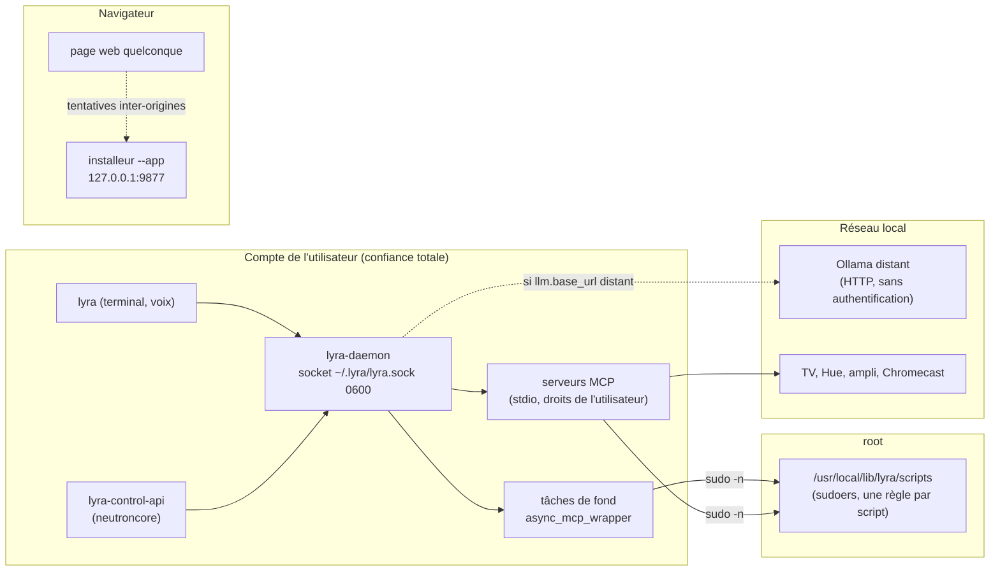

# Modèle de menaces

Qui peut attaquer quoi, où sont les frontières de confiance, ce qui protège aujourd'hui et ce qui
reste ouvert. Établi le 2026-10-16 par relecture du code ; chaque mesure renvoie au code qui la
tient. Les décisions sous-jacentes sont dans les [notes d'architecture](adr/index.md).

## Ce qu'on protège

- **La machine** : Lyra peut démarrer, arrêter, cloner et détruire des VM, créer et restaurer des
  sauvegardes, avec des scripts lancés en root ([ADR-005](adr/ADR-005-sudoers-par-script.md)).
- **Les appareils du réseau local** : TV, lampes, ampli, Chromecast, par les serveurs MCP.
- **Les données** : texte des requêtes, historique, secrets des appareils (`secrets.yaml`), noms
  de VM et chemins de sauvegarde. Le détail est dans [Flux de données](user/DATA_FLOWS.md).

## Vue d'ensemble

Les flèches en pointillé traversent une frontière de confiance.

## Acteurs

| Acteur | Ce qu'il peut faire aujourd'hui |
|---|---|
| Un processus du compte de l'utilisateur | Tout ce que fait Lyra : il peut parler au socket (y compris déclarer une action déjà confirmée sur la route `tool`), et appeler directement les scripts autorisés par sudoers avec ses propres arguments. Ce n'est pas une frontière : on considère ce compte comme de confiance. |
| Un autre compte de la machine | Pas d'accès au socket (0600). Pouvait lire les fichiers de tâches dans `/tmp` et l'adresse du webhook Discord dans la liste des processus (corrigé, voir plus bas). |
| Une page web ouverte dans le navigateur | Lyra n'ouvre aucun port. Seul l'installeur graphique écoute, pendant `install.sh --app`, sur `127.0.0.1:9877` (voir plus bas). |
| Un appareil du réseau local | Peut se faire passer pour un Ollama distant (le serveur choisit l'outil et ses arguments), ou renvoyer des données trompeuses aux serveurs MCP. |
| Un serveur MCP malveillant ou compromis | Tourne avec les droits de l'utilisateur et tout son environnement ; ses descriptions d'outils orientent la recherche ; sa sortie est lue par le modèle de dialogue. |
| Un texte piégé (injection de prompt) | Peut arriver par la voix, le texte, ou la sortie d'un outil (nom d'application TV, contenu de fichier). |

## Frontières et ce qui les protège

| Frontière | Protection | Où |
|---|---|---|
| Socket du démon | fichier 0600, protocole typé, outils hors catalogue refusés | [`lyra/daemon/server.py`](../lyra/daemon/server.py), [`protocol.py`](../lyra/daemon/protocol.py) |
| Action sensible | confirmation humaine ; les outils dangereux exigent un « oui » explicite, jamais automatique, même en mode performance ou avec `-y` | [`lyra/core/constants.py`](../lyra/core/constants.py), [`lyra/daemon/actions.py`](../lyra/daemon/actions.py), [tests](../tests/unit/test_confirm_prompt.py) |
| Automatisations sans humain (`unattended`) | seuls les outils domestiques de `PERFORMANCE_TOOLS` passent ; rien ne pose de question | `handle_tool` dans [`server.py`](../lyra/daemon/server.py) |
| Analyse d'une phrase pour les automatisations | règles seules, rien n'est exécuté | [`lyra/daemon/analysis.py`](../lyra/daemon/analysis.py) |
| Passage à root | copie root des scripts, une règle sudoers par script, `visudo -cf`, aucun binaire générique | [ADR-005](adr/ADR-005-sudoers-par-script.md) |
| Arguments vers les scripts | listes blanches (noms, chemins, textes), jamais de shell | [`scripts/async_mcp_wrapper.py`](../scripts/async_mcp_wrapper.py) |
| Secrets des appareils | `secrets.yaml` en 0600, refus d'écrire un secret dans `config.yaml` | [`installer/core/configpatch.py`](../installer/core/configpatch.py) |
| Sortie d'un outil vers le modèle | lue seulement par LYRA pour la réponse, tronquée à 1000 caractères ; elle ne choisit jamais l'outil suivant | [`lyra/models/lyra_voice.py`](../lyra/models/lyra_voice.py) |
| Données gardées | `lyra --purge` efface et vérifie | [`lyra/utils/purge.py`](../lyra/utils/purge.py) |
| Proxy d'entreprise | la boucle locale est ajoutée à `NO_PROXY` : Ollama local, suivi et MCP ne partent pas au proxy | [`lyra/utils/netenv.py`](../lyra/utils/netenv.py) |

## Risques connus

Relevés le 2026-10-16. « Proposé » signifie qu'une correction attend d'être fusionnée.

| Risque | État |
|---|---|
| **Installeur graphique pilotable par une page web** : sans contrôle d'Host, d'Origin ni de type de contenu, une page pouvait lancer l'installation, répondre aux confirmations (identifiants `ask-1`, `ask-2`…) et injecter du code dans `~/.bashrc` par `ollama_host`. | proposé ([#42](https://github.com/amineutron/lyra/pull/42)) |
| **Annotation MCP `destructiveHint` ignorée par le démon** : un outil qu'un serveur tiers déclare destructif n'avait qu'une confirmation souple, et `-y` l'exécutait. | proposé ([#41](https://github.com/amineutron/lyra/pull/41)) |
| **Fichiers des tâches de fond dans `/tmp`**, lisibles par tous, noms prévisibles ; **webhook Discord en argument** de processus ; socket passé en 0600 juste après sa création. | proposé ([#43](https://github.com/amineutron/lyra/pull/43)) |
| **Scripts sudoers : arguments libres.** Une règle autorise n'importe quels arguments ; un processus du compte peut appeler directement l'import de VM ou la restauration de sauvegarde. La sûreté dépend de la validation faite par chaque script, et le groupe `libvirt` donne à lui seul un pouvoir proche de root. | ouvert : faire valider leurs arguments par les scripts (dépôt fedora-agents) |
| **Ollama distant en HTTP clair, sans authentification** : le texte des requêtes traverse le réseau ; un faux serveur choisit l'outil et ses arguments (les outils dangereux restent soumis au « oui »). | ouvert : joindre Ollama par un tunnel (SSH, WireGuard) ou un proxy HTTPS ; `llm.base_url` accepte une URL `https://` complète |
| **Serveurs MCP** : tout l'environnement de l'utilisateur, dépôts clonés à la dernière version sans épinglage ni vérification de signature, scripts `npm install` exécutés. | ouvert : épingler les versions dans le catalogue |
| **Webhook Discord lu seulement dans `config.yaml`** alors que la documentation l'annonce dans `secrets.yaml` (les secrets finissaient dans le fichier non protégé, ou les notifications ne partaient pas). | proposé ([#43](https://github.com/amineutron/lyra/pull/43)) |
| **Injection de prompt résiduelle** : la sortie d'un outil peut faire dire à LYRA un texte trompeur (par exemple une fausse consigne) ; les descriptions d'outils d'un serveur orientent le choix d'EPHAISTOS. | atténué (la sortie ne pilote jamais l'outil suivant ; les actions sensibles restent confirmées) |
| **Installation locale d'Ollama par le script officiel**, téléchargé depuis ollama.com et exécuté par le shell. | assumé (méthode officielle ; bundle hors ligne possible, voir [Derrière un proxy, sans Internet](reseau.md)) |
| **Route `tool` : le client peut déclarer une action déjà confirmée.** | assumé (le socket n'est ouvert qu'au compte de l'utilisateur ; neutroncore vérifie sa propre confirmation avant d'appeler) |
| `secrets.yaml` réglé en 0600 juste après son écriture ; ses copies `.bak-*` restent sur le disque. | ouvert, faible |

## Hors périmètre

- Un attaquant root, ou qui exécute déjà du code sous le compte de l'utilisateur : il a de toute
  façon les droits que Lyra utilise.
- La sécurité propre des appareils pilotés (TV, pont Hue, ampli) et de leurs protocoles.
- lyra-control-api et neutroncore, qui ont leur propre authentification (clé, jeton de
  confirmation).
